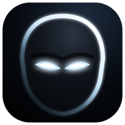

# Watcher Assistant

**I am the Watcher. I observe… and I do not interfere. Mostly.**

A notch for Windows that watches over Claude Code and keeps your day within reach.

### [⬇ Download for Windows](https://github.com/rajamanistark/watcher-assistant/releases/latest)

Windows 10 and 11 · Free · Updates itself

---

## What is Watcher Assistant?

Watcher Assistant lives at the top of your screen as a small black notch. It stays out of the way until something needs you.

Hover over it, and it opens into a panel with everything you need at a glance. You can scroll to move between its *senses*.

A silhouette face with glowing eyes reacts to what is happening:
- It looks busy while Claude works.
- It looks alert when Claude needs your approval.
- It looks pleased when a task is done.

Watcher can speak in its own voice ("*I see you.*") or plainly. You choose.

## What it can do

### Claude Code, live
See what Claude Code is doing as it happens: which file it's editing and which command it's running. When Claude asks permission, the notch opens and you **Allow** or **Deny** right there, without switching to the terminal. When the work is done, Watcher tells you.

### Ask Watcher
Ask a question about anything on your screen. Watcher takes a look and answers using **your own Claude subscription**, with no API key and no extra cost.
- **Models.** Choose Haiku for speed, or Sonnet or Opus for harder jobs.
- **Calendar.** Ask it to add an event to your calendar.
- **PC control (optional).** Turn it on, and Watcher can run commands on your PC for you.
  - Read-only commands run on their own.
  - Anything that changes your files, apps or settings asks you first.
  - Risky commands are always blocked.
  - Press **Ctrl + Alt + Esc** to stop it at any moment.

### Calendar
Connect your Google Calendar and see:
- **A month view.** Days with events are marked; click a day to read its events.
- **Coming up.** Your next events, with a live countdown.
- **Event details.** Time, place (opens in Maps) and description, with a **Join** button for Meet, Zoom and Teams calls.

You can add several calendars, each with its own colour. Watcher reminds you before events start.

### And more
| Sense | What it shows |
|---|---|
| 🎵 **Music** | What's playing in any app, with play/pause/skip and a visualizer |
| 📋 **Clipboard** | Your last 25 copies. Kept in memory only; passwords and secrets are never recorded |
| 📁 **Shelf** | Drop files on the notch to keep them handy, then drag them out wherever you need them |
| 📊 **Claude usage** | How much of your Claude plan you've used, and when it resets. Watcher warns you at 80% |
| 🎛 **Control Center** | Wi-Fi, Bluetooth, Focus, volume and brightness |
| 🔋 **Status** | Clock, weather, battery and battery health |

You can turn senses on or off and put them in any order in Settings.

### Stays out of your way
- **Games and videos.** Watcher hides by itself in fullscreen games and videos.
- **Hide for a while.** Hide it for an hour, two hours, or until you bring it back.
- **Updates.** When a new version is out, Watcher tells you. One click installs it, inside the app.

## Install

1. **[Download the latest installer](https://github.com/rajamanistark/watcher-assistant/releases/latest).** It is the file ending in `-setup.exe`.
2. **Open it** and follow the short steps. No administrator rights are needed.
3. **Meet the Watcher.** A short welcome tells you about it, asks your name, and helps you link Claude Code.

> **Windows may show "Windows protected your PC"** because the installer is new. Click **More info → Run anyway**.

### What you need
- Windows 10 or 11 (64-bit).
- For the Claude features: [Claude Code](https://claude.com/claude-code), signed in with your Claude account. Watcher helps you set this up during the welcome.

## Privacy

- **Everything stays on your computer.** Watcher has no account and no servers, and collects no analytics.
- **Your clipboard** is kept in memory only. It is never saved to disk and is cleared when Watcher closes.
- **Screen questions** are sent to Claude only when you ask one, through your own Claude Code.
- **Your calendar link** is stored only on your PC.
- **Updates** are downloaded from this page's releases and are signed, so Watcher installs only genuine versions.

## Questions

**Is it free?** Yes.

**Do I need Claude?** Music, calendar, clipboard, shelf, controls and status all work without it. Claude Code is needed only for the Claude activity, approvals and Ask Watcher.

**How do I close it?** Right-click the Watcher icon in the system tray and choose **Quit Watcher**.

**How do I uninstall it?** Go to Windows **Settings → Apps → Installed apps → Watcher → Uninstall**.

**Found a problem?** [Open an issue](https://github.com/rajamanistark/watcher-assistant/issues) and describe what happened.

---

Watcher Assistant is an independent project and is not affiliated with Anthropic.

